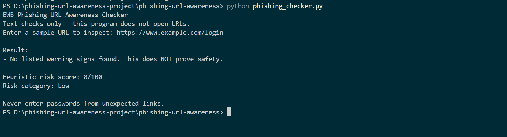
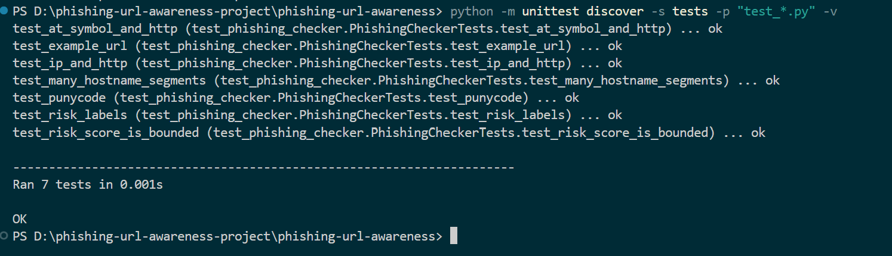

# EWB Phishing URL Awareness Checker

## Overview
Phishing is a social-engineering attack where malicious links mimic authentic services to trick users into revealing sensitive credentials, passwords, or personal data. The EWB Phishing URL Awareness Checker is a beginner-friendly, defensive security tool that inspects visible URL text patterns for common indicators of deception. The program operates purely via static text analysis and never visits, connects to, or sends requests to target websites.

## Features
- Detects an @ symbol in the URL
- Flags unusually long URLs (over 100 characters)
- Flags IP-address hostnames
- Flags many hostname segments (5 or more)
- Flags punycode-style hostnames (xn--)
- Flags the HTTP scheme
- Heuristic risk scoring engine (0 to 100 points) and risk categorization (Low, Medium, High)
- Robust input sanitization and crash protection for malformed URLs and missing schemes

## Requirements
Python 3.10 or later. No extra packages.

## How to Run
Windows:  `python phishing_checker.py`  
Mac/Linux: `python3 phishing_checker.py`

## Example Output
```text
PS D:\phishing-url-awareness-project\phishing-url-awareness> python phishing_checker.py
EWB Phishing URL Awareness Checker
Text checks only - this program does not open URLs.
Enter a sample URL to inspect: https://www.example.com/login

Result:
- No listed warning signs found. This does NOT prove safety.

Heuristic risk score: 0/100
Risk category: Low

Never enter passwords from unexpected links.
```

## Testing
| # | Input | Expected | Actual | Result |
|---|-------|----------|--------|--------|
| 1 | `https://www.example.com/login` | No warning signs | No listed warning signs found. This does NOT prove safety. | PASS |
| 2 | `http://192.0.2.10/account` | IP address + HTTP | Uses an IP address instead of a familiar domain. \| Uses HTTP. HTTPS alone does not prove trust. | PASS |
| 3 | `http://example.com@sample.invalid/login` | @ symbol + HTTP | Contains an @ symbol; inspect carefully. \| Uses HTTP. HTTPS alone does not prove trust. | PASS |
| 4 | `https://a.b.c.d.e.example.invalid/path` | Many hostname segments | Contains many hostname segments/subdomains. | PASS |
| 5 | `https://xn--example.invalid/` | Punycode-style hostname | Contains a punycode-style hostname. | PASS |

Full test evidence and reflection notes are logged in [tests/test_samples.md](tests/test_samples.md).

Automated unit testing can also be run anytime with:
```bash
python -m unittest discover -s tests -p "test_*.py" -v
```

## Screenshots




## Improvements
1. **Heuristic Risk Scoring and Categorization**
   - *What changed:* Implemented `calculate_risk()` and `risk_label()` to compute a normalized risk score (0 to 100) based on weighted severity of all detected flags and map it to `Low`, `Medium`, or `High`.
   - *Why:* Provides users with an immediate, clear summary of cumulative risk rather than requiring them to interpret isolated findings.
   - *How tested:* Validated with dedicated unit tests (`test_risk_score_is_bounded`, `test_risk_labels`) and manual terminal runs across multiple threat combinations.
2. **Safe Exception Handling and Missing Scheme Autocompletion**
   - *What changed:* Wrapped URL parsing in `try...except (ValueError, UnicodeError)` to prevent crashes from malformed inputs (e.g. invalid IPv6 brackets like `http://[bad`), rejected internal whitespace/control characters, and automatically prepended `http://` when schemes are missing (e.g. `www.example.com`).
   - *Why:* Prevents unhandled tracebacks in terminal execution and ensures URLs missing a scheme are still reliably inspected.
   - *How tested:* Tested with malformed strings (`http://[bad`), empty inputs, URLs containing control characters, and standard domain strings without protocol schemes.

## Limitations
This is an educational tool. It only reads URL text. It does not visit URLs, scan for malware or prove that a URL is safe. No warning signs found does NOT mean a URL is safe.

## Ethical Use
Use sample strings only. Do not collect credentials. Do not use this project to deceive anyone or to test websites without permission.

## Author
Kanhaiya Patidar, Cybersecurity Internship / Mini Project, EWB Courses
